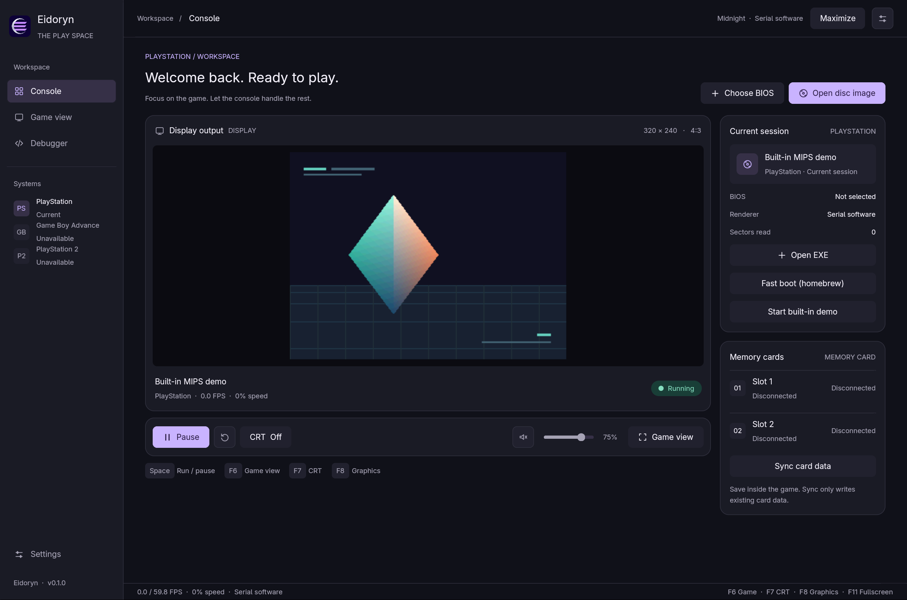
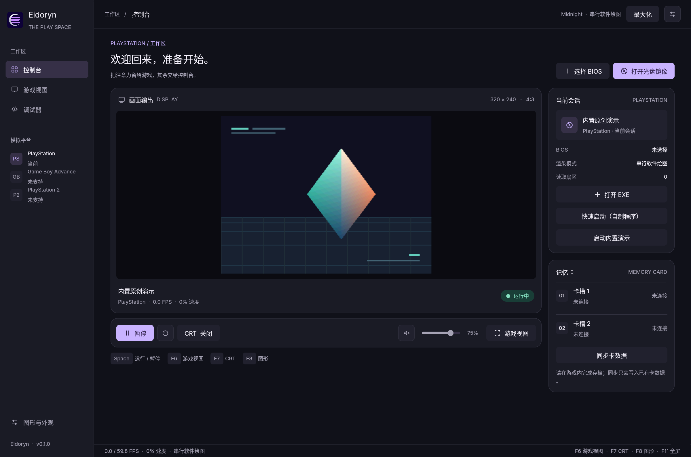

# Eidoryn

[](#current-status)
[](https://www.rust-lang.org/)
[](https://www.gpui.rs/)
[](#current-status)
[](LICENSE)

Experimental project developed with extensive AI assistance. Hardware accuracy and game compatibility are still under active development.

**English** | [简体中文](README.zh-CN.md)

[Project Overview](#project-overview) · [Features](#features) · [Current Status](#current-status) · [Getting Started](#getting-started) · [Controls](#controls) · [Architecture](#architecture) · [Documentation](#documentation) · [Roadmap](#roadmap) · [License & Acknowledgments](#license--acknowledgments)

## Project Overview

Eidoryn is an experimental emulator written in Rust with a native GPUI interface. Its current PlayStation (PS1) core provides game execution, graphics settings, and hardware debugging. The CPU, GPU, audio, disc drive, and other emulated components are implemented in this project; no third-party emulator core is integrated.

The architecture leaves room for additional systems, but **GBA and PS2 are not currently supported**. No game images, BIOS files, or saves are included.

<p align="center">
  
  <br>
  <sub>The native GPUI console in the Midnight theme, running the original built-in demo. No BIOS or game image is required.</sub>
</p>

<details>
<summary>Simplified Chinese interface</summary>



</details>

## Features

- **PS1 emulation:** MIPS CPU, GTE, GPU, MDEC, SPU, disc drive, DMA, timers, a shared CPU/device cycle timeline, and a digital controller.
- **Graphics and performance options:** serial and multithreaded software rendering, optional Vulkan acceleration, enlarged and fullscreen views, and a CRT display filter.
- **Desktop experience:** English and Simplified Chinese, keyboard navigation, four built-in themes, JSON theme plugins, saved preferences, a volume slider, and system audio output.
- **Media and saves:** ISO, BIN, and multi-track CUE/BIN images; two memory-card slots with automatic persistence.
- **Debugging tools:** An optional debugger with CPU registers, disassembly, single stepping, and execution slices; an experimental JIT and a headless CLI. Enable the debugger in its workspace or start with `--debugger`.

## Current Status

| Area | Status |
| --- | --- |
| Emulated systems | PlayStation (PS1) is in development; other systems are not implemented. |
| Host platforms | Linux x86-64 has been used for development and testing. Windows and macOS headless CLI builds have passed CI smoke tests; their desktop interfaces still need hands-on runtime validation. |
| Rendering | Serial software rendering is the default. Multithreaded software rendering and Vulkan can be selected in **Settings → Graphics / F8** when included in the build. |
| CPU JIT | Experimental and disabled by default; supports a subset of integer instructions on Linux x86-64 only. |
| Accuracy and compatibility | Device timing, graphics, and audio are not cycle-accurate. Compatibility and performance vary by game, scene, and host. |

Save states, CHD images, and disc swapping are not supported. Memory-card saves must be made at a save point or through the game's own menu. See [testing](docs/TESTING.md) and [performance](docs/PERFORMANCE.md) for coverage and measurement details.

## Getting Started

### Requirements

- Rust **1.95 or newer** and Cargo. A release build is recommended for running games.
- The desktop build requires GPUI's system graphics, font, and audio development libraries, plus a working graphics driver. See the [release workflow](https://github.com/Opynicus/Eidoryn/blob/main/.github/workflows/release.yml) for Linux build dependencies and the [desktop integration guide](packaging/README.md) for optional launcher installation.
- Vulkan rendering requires a physical Vulkan-capable GPU and driver. The default software renderer does not require Vulkan hardware.
- Bring your own BIOS and game images; they are not supplied by this project.

See [GitHub Releases](https://github.com/Opynicus/Eidoryn/releases) for available builds. Check each asset's name for its platform and whether it is a desktop or headless CLI build. Windows and macOS release builds use software rendering.

### Build and launch

```bash
git clone https://github.com/Opynicus/Eidoryn.git
cd Eidoryn
cargo run --locked --release
```

Without media, Eidoryn opens its original built-in demo without requiring a BIOS. After building, the executable is at `target/release/eidoryn` on Linux and macOS, or `target/release/eidoryn.exe` on Windows. `--locked` fixes dependency versions; `--release` enables optimizations.

### Interface language

Choose **Settings → Appearance → Language** to switch between **English** and **简体中文** immediately. The choice is saved for the next launch. On first launch, a Chinese locale selects Simplified Chinese; other locales use English.

Use `--language en` or `--language zh-CN` to override the language for one session. See [interface language settings](docs/UI.md#界面语言) for configuration paths and translation scope.

Theme, CRT, volume, mute state, preferred renderer, and fullscreen controls are also saved. CLI options override saved preferences for the current session; for example, `--theme ocean --volume 60 --crt soft`. Enable **Settings → Graphics → Clean fullscreen** to hide controls while fullscreen, or use `--fullscreen --clean-fullscreen`.

### Load a game

1. Select **Choose BIOS** and load your own 512 KiB BIOS file.
2. Select **Open disc image** and load an ISO or CUE file. For a multi-track BIN image, select the `.cue` that references all tracks.
3. Select **Run**. Press **F11** to enter or leave fullscreen.

You can also start from the command line:

```bash
cargo run --locked --release -- \
  --bios /path/to/bios.bin --disc /path/to/game.cue --run
```

Memory cards default to `saves/card1.mcd` and `saves/card2.mcd` relative to the current working directory. Use `--card1 PATH` and `--card2 PATH` to choose other files. `--fast-boot` skips BIOS initialization and is intended only for homebrew that does not rely on BIOS services. Run `cargo run --locked --release -- --help` for more options.

<details>
<summary>Headless build and tests</summary>

```bash
cargo run --locked --release --no-default-features -- --headless --no-memory-cards --frames 120
cargo test --locked --workspace
```

With default features disabled, the core and CLI use only the Rust standard library. `--frames` counts execution slices, not video frames.

</details>

## Controls

| Keyboard | PS1 controller |
| --- | --- |
| Arrow keys | D-pad |
| `X` / `Z` / `S` / `D` | Cross / Square / Triangle / Circle |
| `Enter` / `Backspace` | Start / Select |
| `Q` / `E` | L1 / R1 |
| `A` / `F` | L2 / R2 |

| Shortcut | Action |
| --- | --- |
| `Space` | Run / pause |
| `F6` / `F7` / `F8` | Toggle game view / CRT filter / graphics settings |
| `F11` / `Esc` | Toggle fullscreen / exit fullscreen |
| `F12` | Show or hide fullscreen controls |
| `F9` / `F10` | Run one slice / step one instruction |
| `Ctrl+R` | Reset the current session |

Use **Tab / Shift+Tab** to navigate controls and **Enter / Space** to activate them. Arrow keys adjust a focused volume slider; **Esc** closes settings or returns keyboard input to the game. Icon buttons show descriptions on hover.

## Architecture

```text
CLI / GPUI
    │
    ├── systems::ps1 ──→ eidoryn-ps1 ──→ optional JIT runtime
    │     media, cards,      PS1 hardware core
    │     and worker
    └── eidoryn-host
          audio, CRT filters, and themes
```

The emulation worker owns the PS1 machine; the interface communicates through commands and snapshots. `crates/ps1` contains the independent hardware core, `crates/host` provides reusable host services, and `src/systems/ps1` adapts PS1 sessions to the application. See [architecture](docs/ARCHITECTURE.md) for boundaries and data flow.

## Documentation

Most detailed hardware documents are currently in Chinese.

| Document | Contents |
| --- | --- |
| [Architecture](docs/ARCHITECTURE.md) | Modules, threads, and data flow |
| [Desktop workspaces](docs/UI.md) | Console, debugger, game view, and settings |
| [Memory by module](docs/UI-MEMORY-MODULES.md) | Measurements, optional debugger, and resource loading |
| [Renderer memory](docs/RENDERER-MEMORY.md) | Runtime switching, process RSS, and Vulkan allocation costs |
| [Timing](docs/TIMING.md) · [Rendering](docs/RENDERING.md) · [JIT](docs/JIT.md) | CPU/device cycles, graphics backends, and CPU execution |
| [Audio](docs/AUDIO.md) · [Memory cards](docs/SAVES.md) | Output, persistence, and limitations |
| [Theme plugins](docs/THEMES.md) | Built-in themes and the custom JSON format |
| [Testing](docs/TESTING.md) · [Performance](docs/PERFORMANCE.md) | Validation, benchmarks, and their scope |
| [Linux desktop integration](packaging/README.md) · [Third-party information](THIRD_PARTY.md) | Launcher installation, dependencies, and hardware references |
| [Contributing](docs/CONTRIBUTING.md) | Feature branches, commits, and validation |

## Roadmap

- Improve PS1 device timing, audio accuracy, and game compatibility; expand regression coverage.
- Continue measuring frame time, audio latency, and Vulkan readback costs before optimizing further.
- Validate and improve Windows and macOS desktop execution and release workflows.
- Explore additional system cores within the existing module boundaries; there is no implementation commitment or timeline for GBA or PS2.

## License & Acknowledgments

The project is licensed under [GPL-3.0-only](LICENSE). [LICENSE-MIT](LICENSE-MIT) preserves the license notice for the original prototype. See [THIRD_PARTY.md](THIRD_PARTY.md) for dependencies and hardware references.

Hardware behavior is informed by [PSX-SPX](https://psx-spx.consoledev.net/); the desktop interface uses [GPUI](https://www.gpui.rs/). Development makes extensive use of AI assistance, and hardware behavior and compatibility remain under active validation.
