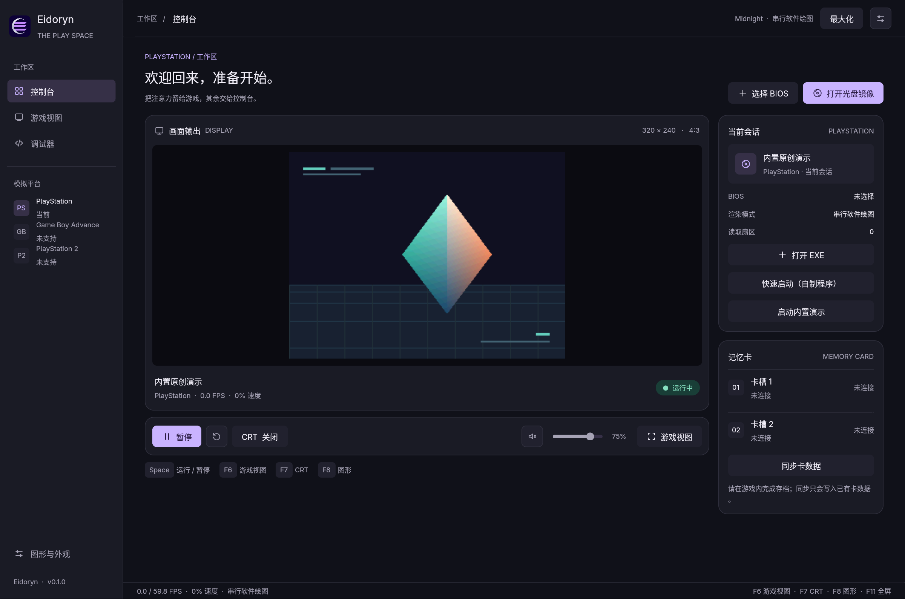
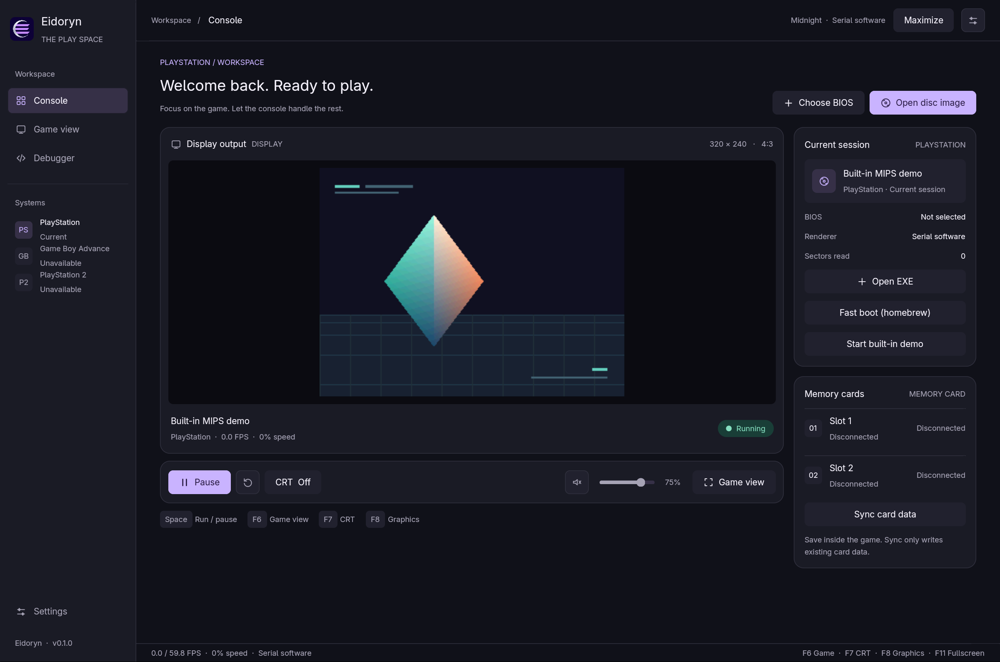

# Eidoryn

[](#当前状态)
[](https://www.rust-lang.org/)
[](https://www.gpui.rs/)
[](#当前状态)
[](LICENSE)

这是一个广泛使用 AI 辅助开发的实验性项目。硬件精度与游戏兼容性仍在持续开发中。

[English](README.md) | **简体中文**

[项目概览](#项目概览) · [功能](#功能) · [当前状态](#当前状态) · [快速开始](#快速开始) · [按键](#按键) · [架构](#架构) · [文档](#文档) · [路线图](#路线图) · [许可证与致谢](#许可证与致谢)

## 项目概览

Eidoryn 是一个使用 Rust 编写的实验性模拟器，配备原生 GPUI 界面。目前实现了 PlayStation（PS1）核心，提供游戏运行、图形设置和硬件调试功能。项目自主实现了 CPU、GPU、音频、光驱等模拟组件，没有集成其他模拟器核心。

架构为未来增加其他主机预留了空间；**目前不支持 GBA 或 PS2**。项目不包含游戏镜像、BIOS 或存档。

<p align="center">
  
  <br>
  <sub>Midnight 主题下的原生 GPUI 控制台与内置原创演示；无需 BIOS 或游戏镜像。</sub>
</p>

<details>
<summary>查看英文界面</summary>



</details>

## 功能

- **PS1 模拟**：MIPS CPU、GTE、GPU、MDEC、SPU、光驱、DMA、计时器、统一 CPU/设备周期时间线和数字手柄。
- **画面与性能选项**：串行软件绘图、多线程软件绘图和可选 Vulkan 加速；支持放大、全屏与 CRT 显示滤镜。
- **桌面体验**：中英文即时切换、键盘导航、四套内置主题、JSON 主题插件、设置持久化、音量滑条与系统音频输出。
- **游戏媒体与存档**：读取 ISO、BIN 和多轨 CUE/BIN；支持双槽记忆卡及自动保存。
- **调试工具**：默认关闭的可选调试器，包含 CPU 寄存器、反汇编、单步和执行切片；可在调试页开启，或使用 `--debugger` 启动。另有实验性 JIT 与无窗口命令行模式。

## 当前状态

| 项目 | 状态 |
| --- | --- |
| 模拟主机 | PlayStation（PS1）进行中；其他主机尚未实现 |
| 宿主平台 | Linux x86-64 已用于开发和测试；Windows、macOS 无窗口 CLI 已通过 CI 冒烟测试，桌面版仍需实际运行验证 |
| 渲染 | 默认串行软件绘图；构建包含相应后端时，可在 **图形与外观 / F8** 中切换多线程软件绘图和 Vulkan |
| CPU JIT | 实验性功能，默认关闭，仅支持 Linux x86-64 的部分整数指令 |
| 精度与兼容性 | 设备时序、图形和音频并非周期精确；游戏兼容性和性能因场景与设备而异 |

目前不支持即时存档、CHD 或运行中换盘。记忆卡存档需要在游戏自身的存档点或菜单中完成。具体范围和测量结果见[验证说明](docs/TESTING.md)与[性能报告](docs/PERFORMANCE.md)。

## 快速开始

### 环境要求

- Rust **1.95 或更新版本**及 Cargo；建议使用 release 构建运行游戏。
- 桌面版需要 GPUI 所需的系统图形、字体与音频开发库，以及可用图形驱动。Linux 构建依赖示例见[发布工作流](https://github.com/Opynicus/Eidoryn/blob/main/.github/workflows/release.yml)；[桌面集成说明](packaging/README.md)介绍了可选的启动器安装方式。
- Vulkan 模式需要支持 Vulkan 的物理显卡和驱动；默认软件模式不要求 Vulkan 硬件。
- 启动游戏需要自行准备相应 BIOS 和镜像。项目不提供这些文件。

可在 [GitHub Releases](https://github.com/Opynicus/Eidoryn/releases) 查看已发布的构建；请根据附件名称区分桌面版和无窗口 CLI 版，并留意各平台的验证状态。Windows 和 macOS 发布包使用软件绘图。

### 构建与启动

```bash
git clone https://github.com/Opynicus/Eidoryn.git
cd Eidoryn
cargo run --locked --release
```

未指定媒体时会打开内置原创演示，无需 BIOS。构建后可运行 Linux/macOS 的 `target/release/eidoryn` 或 Windows 的 `target/release/eidoryn.exe`。`--locked` 固定依赖版本，`--release` 才会启用优化。

### 界面语言

在 **图形与外观 → 外观主题 → 语言** 中选择 **English** 或 **简体中文**，界面立即切换，并保存供下次启动使用。首次启动时，中文系统语言选择简体中文，其余语言默认使用英文。

可通过 `--language en` 或 `--language zh-CN` 临时指定本次启动语言。配置文件位置与翻译范围见[界面语言说明](docs/UI.md#界面语言)。

主题、CRT、音量、静音状态、首选渲染器和全屏控制栏也会保存。启动参数优先于已保存设置，例如 `--theme ocean --volume 60 --crt soft`。在 **图形与外观 → 图形设置 → 纯画面全屏** 中隐藏全屏控制栏，也可用 `--fullscreen --clean-fullscreen` 启动。

### 加载游戏

1. 在界面中选择 **选择 BIOS**，加载自己的 512 KiB BIOS。
2. 选择 **打开光盘镜像**，加载 ISO 或 CUE；多轨 BIN 镜像请选择关联所有轨道的 `.cue` 文件。
3. 点击 **运行** 开始运行。使用 **F11** 进入或退出全屏。

也可以从命令行启动：

```bash
cargo run --locked --release -- \
  --bios /path/to/bios.bin --disc /path/to/game.cue --run
```

记忆卡默认位于当前工作目录的 `saves/card1.mcd` 和 `saves/card2.mcd`；可用 `--card1 PATH`、`--card2 PATH` 指定其他文件。`--fast-boot` 会跳过 BIOS 初始化，仅适用于不依赖 BIOS 服务的自制程序。更多选项可运行 `cargo run --locked --release -- --help` 查看。

<details>
<summary>无窗口构建与测试</summary>

```bash
cargo run --locked --release --no-default-features -- --headless --no-memory-cards --frames 120
cargo test --locked --workspace
```

无默认特性的核心与命令行仅使用 Rust 标准库。`--frames` 表示执行切片数，而不是视频帧数。

</details>

## 按键

| 键盘 | PS1 手柄 |
| --- | --- |
| 方向键 | 方向键 |
| `X` / `Z` / `S` / `D` | Cross / Square / Triangle / Circle |
| `Enter` / `Backspace` | Start / Select |
| `Q` / `E` | L1 / R1 |
| `A` / `F` | L2 / R2 |

| 快捷键 | 操作 |
| --- | --- |
| `Space` | 运行 / 暂停 |
| `F6` / `F7` / `F8` | 切换游戏视图 / CRT 滤镜 / 图形设置 |
| `F11` / `Esc` | 切换全屏 / 退出全屏 |
| `F12` | 显示或隐藏全屏控制栏 |
| `F9` / `F10` | 执行一个切片 / 单条指令 |
| `Ctrl+R` | 重置当前会话 |

使用 **Tab / Shift+Tab** 移动控件焦点，**Enter / Space** 激活；音量滑条聚焦后可用方向键调整。**Esc** 收起设置或将键盘输入交还游戏，鼠标悬停图标按钮可查看说明。

## 架构

```text
CLI / GPUI
    │
    ├── systems::ps1 ──→ eidoryn-ps1 ──→ 可选 JIT runtime
    │     媒体、存档、运行线程       PS1 硬件核心
    │
    └── eidoryn-host
          音频、CRT 滤镜与主题
```

PS1 机器状态由运行线程持有；界面通过命令和快照与其交互。`crates/ps1` 是独立硬件核心，`crates/host` 提供可复用宿主功能，`src/systems/ps1` 负责 PS1 会话适配。设计边界与数据流见[架构文档](docs/ARCHITECTURE.md)。

## 文档

| 文档 | 内容 |
| --- | --- |
| [架构](docs/ARCHITECTURE.md) | 模块边界、线程与数据流 |
| [桌面工作区](docs/UI.md) | 控制台、调试器、游戏视图与设置 |
| [各模块内存占用](docs/UI-MEMORY-MODULES.md) | 实测结果、调试器开关与资源加载 |
| [渲染器内存](docs/RENDERER-MEMORY.md) | 运行时切换、进程 RSS 与 Vulkan 分配开销 |
| [周期模型](docs/TIMING.md) · [渲染后端](docs/RENDERING.md) · [JIT](docs/JIT.md) | CPU/设备周期、图形加速和 CPU 执行 |
| [音频](docs/AUDIO.md) · [记忆卡](docs/SAVES.md) | 输出、保存与已知限制 |
| [主题插件](docs/THEMES.md) | 内置主题与自定义 JSON 格式 |
| [测试](docs/TESTING.md) · [性能](docs/PERFORMANCE.md) | 验证方法、基准结果及适用范围 |
| [Linux 桌面集成](packaging/README.md) · [第三方资料](THIRD_PARTY.md) | 启动器安装、依赖与硬件参考 |
| [贡献指南](docs/CONTRIBUTING.md) | 特性分支、提交规范与验证 |

## 路线图

- 提升 PS1 设备时序、音频精度和游戏兼容性，扩大回归测试范围。
- 继续测量帧时间、音频延迟和 Vulkan 读回开销，按证据优化性能。
- 验证并完善 Windows、macOS 的构建、运行及发布流程。
- 在已有模块边界的基础上探索其他主机核心；GBA 和 PS2 尚无实现承诺或时间表。

## 许可证与致谢

项目采用 [GPL-3.0-only](LICENSE)；[LICENSE-MIT](LICENSE-MIT) 保留原始自研原型的许可声明。第三方依赖及其说明见 [THIRD_PARTY.md](THIRD_PARTY.md)。

硬件行为参考 [PSX-SPX](https://psx-spx.consoledev.net/)；桌面界面使用 [GPUI](https://www.gpui.rs/)。本项目在开发过程中广泛使用 AI 辅助，硬件实现和兼容性仍在持续验证。
